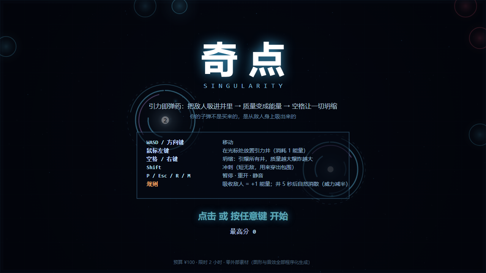
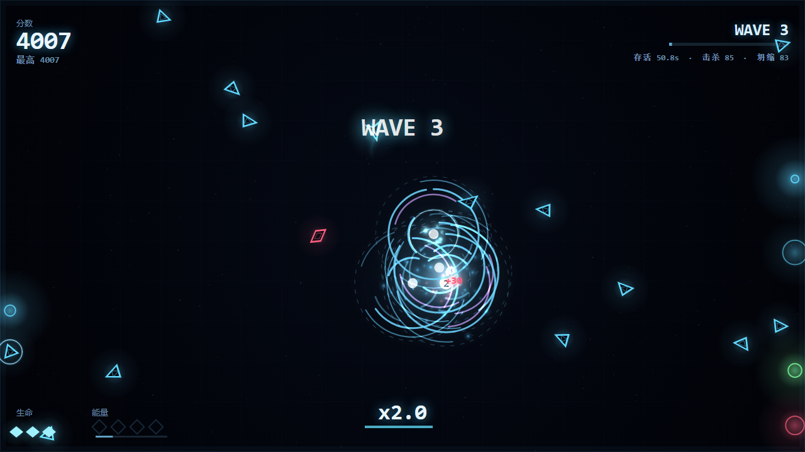
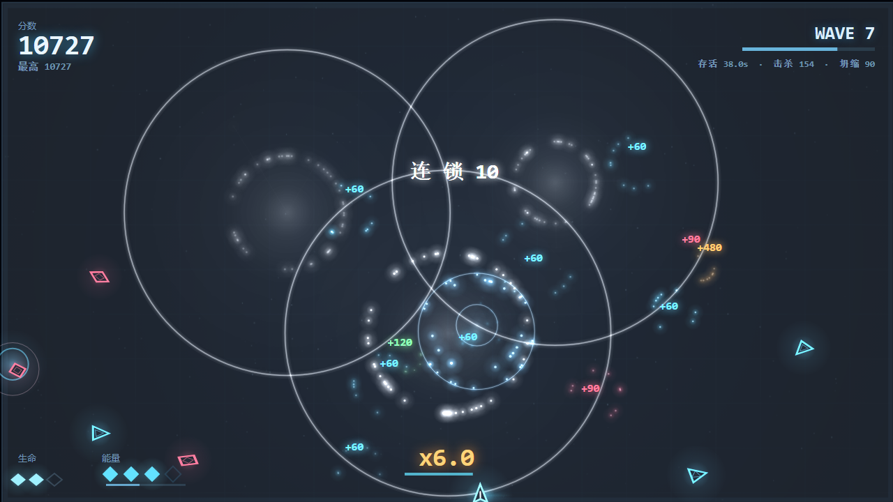

# 奇点 SINGULARITY

**引力即弹药。** 把敌人吸进引力井 → 井里攒下的质量变成你的能量 → 按下空格让所有井**坍缩**，
把攒来的质量变成一次连锁核爆。**你的子弹不是买来的，是从敌人身上吸出来的。**

零外部素材：图形全部 Canvas 程序化绘制，音效与背景音乐全部 WebAudio 实时合成。
**零依赖、零构建、零网络请求** —— 打开 `index.html` 就能玩。

> **English TL;DR** — A dependency-free HTML5 canvas arcade game. You have no gun:
> your only weapon is a **gravity well** that swallows enemies. Each absorbed enemy becomes
> **+1 energy** (ammo is stolen from the enemy), and the well's accumulated mass decides how big
> the **collapse** explosion will be when you detonate it. Kills chain-react, chaining kills
> multiplies your score. All art is drawn procedurally and all sound is synthesized with WebAudio —
> no images, no audio files, no libraries. Written in ~1,700 lines of vanilla JS.

🎮 **在线试玩：<https://wulusai2333.github.io/singularity-game/>**
🎬 **宣传片（58 秒 / 1080p60 / 含音轨）：[promo/out/singularity_promo_1080p60.mp4](promo/out/singularity_promo_1080p60.mp4)**
　└ 不录屏：整支片子是按剧本驱动游戏本体**逐帧渲染**出来的，音效也是按 `render.js` 的合成配方复刻的，
　　所以音画严格同步。流水线见 [`promo/README.md`](promo/README.md)，B 站投稿文案见 [`promo/B站投稿文案.md`](promo/B站投稿文案.md)。





---

## 怎么玩

| 操作 | 作用 |
| --- | --- |
| `WASD` / 方向键 | 移动 |
| 鼠标左键 | 在光标处放置**引力井**（消耗 1 能量） |
| `空格` / 鼠标右键 | **坍缩**：引爆场上所有井，井里攒的质量越大，爆炸半径越大 |
| `Shift` | 冲刺（短无敌，用来从包围里穿出去） |
| `P` / `Esc` | 暂停 |
| `R` | 重开 |
| `M` | 静音 |

**核心循环与三档取舍**

1. **吸收**：敌人被井吸进核心就被吞噬，每吸收 1 个 **+1 能量**（上限 4）——所以弹药是抢来的。
2. **攒 or 炸**：一口井可以一直吸，质量越高坍缩半径越大（`62 + 27 × 质量` 像素）。
   但井只有 **5 秒**寿命，过期自动坍缩且威力减半。攒得越贪，收益越大，浪费风险也越大。
3. **连锁**：坍缩炸死的敌人会二次爆炸（普通 54px、重装 118px），沿敌群一路引爆，
   连击倍率最高 ×6。清场越干净，分数越高。

**敌人分工**（它们的区别就是"该用哪种方式处理"）

| 敌人 | 特点 | 正确处理 |
| --- | --- | --- |
| 漂泊者（青） | 标准单位 | 随便吸 |
| 突击者（红） | 快、几乎不受引力影响 | 别指望吸，直接炸 |
| 分裂体（绿） | 吸进去会裂成 2 个小的 | 用炸的，或用吸的换能量但要收拾残局 |
| 重装（橙） | 极重，引力几乎拉不动 | 必须用攒大的井炸，炸死还有 118px 大范围连锁 |

难度没有终点：每 25 秒一波，波次越高出怪越密、越快，第 5 波起出现重装集群。
单局目标是把分数和连击打高——`localStorage` 会记住你的最高分。

---

## 为什么这样做（设计取舍）

- **没有需求文档** → 先冻结一句话核心循环（吸 → 攒 → 坍缩），所有系统都为这一句话服务；
  砍掉武器、升级树、商店等一切会稀释它的东西。
- **没有素材** → 表现力只能来自"程序化 + 反馈"：加法混合辉光、用背景半透明覆盖白嫖运动模糊、
  冲击波（亮盘 + 热锋 + 放射条纹）、屏幕震动、命中定格、7 杀以上触发慢镜、
  WebAudio 合成的爆炸与五声音阶背景音乐（强度随波次上升）。
- **没有参考素材可抄** → 创意只能来自机制组合本身：把"弹药"从掉落物改成
  "敌人被吞噬后的质量"，于是**打得越好 → 能量越多 → 打得更好**形成正循环，
  而失误（空井、贪心被围）会立刻惩罚你。
- **限时 2 小时** → 架构上把**纯逻辑与表现彻底分离**：
  `game.js` 不碰 DOM，可以在 Node 里以固定步长跑无头对局；`render.js` 负责画和发声。
  这样"调平衡"和"改画面"互不干扰，也让自动化验收成为可能（见下）。

### 架构

```
index.html         34 行   外壳：canvas + 启动
game.js           832 行   纯逻辑（无 DOM）：物理 / 井 / 连锁 / 波次 / 粒子 / 演示 AI
render.js         882 行   表现：程序化美术 + WebAudio 合成 + 输入 + 主循环
tests/simulate.js          无头单元/集成测试（4 万+ 断言）
tests/census.js            对局强度普查（每 10 秒的场上人数/击杀/坍缩，用来调难度）
tests/selftest.html        浏览器层自检（真实事件流：开始/放井/坍缩/暂停/静音/重开/死亡/缩放）
promo/director.js          宣传片导演台：时间轴剧本 + 镜头推拉 + 字幕卡 + 音效日志
promo/capture.js           零依赖 CDP 抓帧器（Node 自带 WebSocket 直连 Chrome）
promo/audio.py             音轨合成：游戏音效复刻 + numpy 现场配乐
```

`game.js` 用固定步长（1/60）推进，与帧率解耦；空间网格负责碰撞查询与分离力，
120 个敌人同屏时单帧逻辑平均 **0.02 ms**。

### 本地运行

```bash
# 方式一：直接双击 index.html（无需服务器）

# 方式二：起个静态服务器
python -m http.server 8000     # 然后打开 http://localhost:8000

# 测试
node tests/simulate.js         # 逻辑层（无浏览器）
node tests/census.js 120       # 对局强度普查
chrome --headless=new --dump-dom tests/selftest.html   # 浏览器层自检
```

调试参数：`index.html?shot=1&t=40&wave=6&nova=1` 会快进到第 40 秒（可用 `nova=1`
强制制造一次"正在坍缩"的高光瞬间），用来截图或复现某个局面。

---

## 验收证据（都是真跑出来的，不是"应该没问题"）

```
$ node tests/simulate.js
[1] 挂机压力测试：存活 12.3s（不还手就会死，说明有威胁）
[2] 能量经济：12 秒吸收 8 个，放井 9 次，坍缩 5 次（正循环成立）
[3] 坍缩连锁：一次爆炸沿链条清掉 19 个（含 1 个重装），连击 x6.0
[4] 分裂体：吸收后裂出 2 个小怪（带 0.6s 免疫，不会被同一口井瞬间再吸）
[5] 井寿命机制：过期自动坍缩，不会白放
[6] 机器人 120 秒对局：7200 帧共 83.5ms（平均 0.012 ms/帧）
[7] 机器人三局存活 90~140 秒（多局波动，难度墙稳定落在第 4~7 波）
=== 结果：41423/41423 项通过 ===
```

```
$ chrome --headless=new --dump-dom tests/selftest.html
SELFTEST-PASSED   （18 项：鼠标世界坐标映射、放井/抬键、冲刺冷却、坍缩清场、
                   暂停不推进、静音开关、重开清零、死亡与重开、缩放、像素非全黑 ✓）
```

**调参过程中被数据推翻的两个判断**（这也是坚持要出图的原因）：

1. 第一版敌人是"一颗一颗挤出来"的，普查显示**前 90 秒场上平均只有 1.5 个敌人**，
   根本攒不出"一网打尽"的爽点 → 改成"小股集群压上 + 涓流"，
   密度变成 6→24，机器人存活从 233 秒降到 126 秒（出现真实难度墙）。
2. 第一版爆炸是几圈又粗又白的圆环 + 一片小死亡环，看着像调试框和肥皂泡 → 改为
   细热锋 + 分层光晕 + 亮盘 + 放射条纹，并只保留一条主伴随文字。

---

## 成本账（预算 ¥100 / 限时 2 小时）

| 项目 | 实际支出 |
| --- | --- |
| 美术素材 | **¥0**（0 张图；全部程序化绘制） |
| 音频素材 | **¥0**（WebAudio 合成：振荡器 + 噪声 + 反馈延迟 + 五声音阶背景乐） |
| 字体 / 第三方库 | **¥0**（系统字体，零依赖） |
| 外部服务 / API | **¥0** |
| 产物 | 3 个文件（2 JS + 1 HTML），共 1,735 行核心代码 |

时间大致分配：**设计定型 ~15% → 实现 ~45% → 调参与无头验收 ~40%**。
预算几乎没花出去——钱全花在"想清楚核心循环"和"反复用截图/无头对局推翻自己的判断"上。

---

## 已知短板（如果还有时间）

- **没有触屏支持**：虚拟摇杆会再吃掉半小时，而手感需要真机验证，本时限内不做半成品。
- **敌人无个体血条**：一律一击必杀以保证可读性，代价是缺少"精英怪"层次。
- **美术是纯几何霓虹**：没有骨骼动画、贴图与后期（泛光/色差都是画出来的近似）。
- **平衡靠机器人代理**：机器人操作近乎完美，人类玩家到达的波次应显著更低，
  正式发布前需要真人试玩数据来微调前 30 秒的密度。
- 下一步优先级：触屏操作 → 精英怪/Boss → 引力井的第二种形态（斥力井）→ 每日挑战种子。

## License

[MIT](LICENSE)
